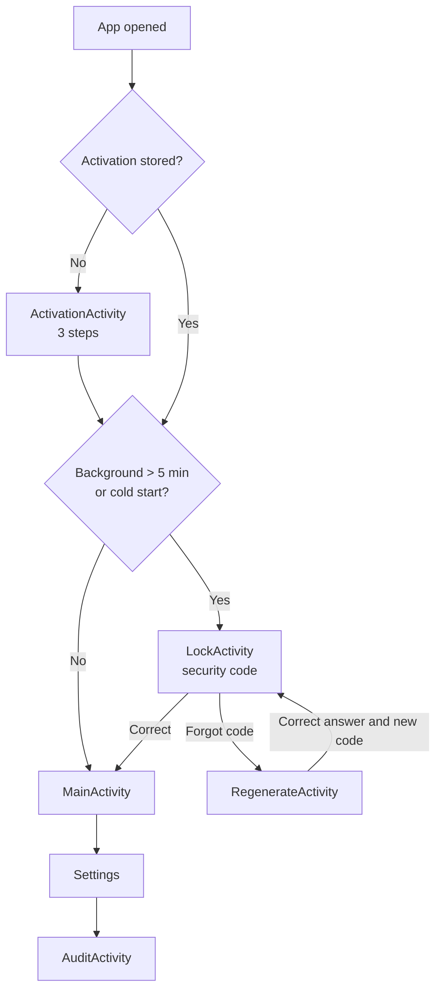

# Plan: Android Digital Wellbeing usage publisher (Java)

## Problem / approach
Build a standalone Java Android app that reads daily usage data on-device and POSTs it to a REST API at a configurable daily time (default 23:55).

Digital Wellbeing has no public API. Its data comes from `UsageStatsManager`, which needs the user-granted "Usage access" permission (`PACKAGE_USAGE_STATS`). This is the on-device equivalent of `adb shell dumpsys usagestats`. `adb` is used only during development, to grant permission and verify data.

## Delivery phases
The app is built in two phases. Phase 2 starts only after Phase 1 is verified on the OnePlus 8.

- **Phase 1: complete standalone app. No data leaves the device.**
  - Covers: scaffold, `UsageCollector` and its aggregation core, `UsagePayload` model, the activation screen, the access lock and regeneration, encrypted storage, the `MainActivity` UI, the scheduler, and the audit screen (last 7 days of local snapshots). Recommendation examples in the mock are illustrative only; actual recommendations require the later API and approvals described in `model-plan.md`.
  - Scheduler: `AlarmManager.setExactAndAllowWhileIdle` fires at the configured publish time, and the receiver re-arms tomorrow's alarm first. `BOOT_COMPLETED` re-arms after reboot. Each alarm run builds the snapshot for the window ending at the publish time and saves it locally (snapshot store, keyed by date and id).
  - Force publish: in Phase 1 it builds a snapshot from 00:00 to now and saves it locally, with the same status display. It does not upload.
  - Status: the publish section shows the last local snapshot (time, trigger, record id) and reads "Saved locally, not published".
  - Results are checked on screen, against the saved snapshot files, and against `adb shell dumpsys usagestats` and `dumpsys alarm`.
  - Todos: `scaffold-project`, `usage-collector`, `settings-ui`, `alarm-receiver-rearm`, `snapshot-store`, `boot-rearm`, `audit-screen`, `secure-storage`, `activation-screen`, `access-lock-regeneration`.
- **Phase 2: publishing the data to the external service.**
  - Covers: `ApiClient` and the upload worker (CONNECTED constraint, backoff, 24-hour give-up limit), device authentication (see Security feature), wiring the snapshots to upload (the external system becomes the long-term store), the status display for upload results, and the locked-phone verification against a mock server.
  - Todos: `payload-api-client`, `device-auth`, `upload-worker`, `force-publish-button` (upload path), and `verify-locked`.

Phase 2 only adds network code on top of Phase 1. Phase 1 code must not depend on any network code.


## Architecture
- Java, min SDK 26, XML views (Java projects pair best with the View system).
- `UsageCollector`: queries `UsageStatsManager.queryEvents` for the local day (00:00 to now).
  - Per-app foreground time, from `ACTIVITY_RESUMED` / `ACTIVITY_PAUSED` pairs.
  - Total screen time, from `SCREEN_INTERACTIVE` / `SCREEN_NON_INTERACTIVE`.
  - Unlock count, from `KEYGUARD_HIDDEN`.
  - Notification count, from `NOTIFICATION_INTERRUPTION`. This is best-effort, because OEM support varies.
- `UsagePayload`: JSON model with date, user id, timezone, totals, and a per-app list. It contains no name, contact, or device identifiers.
- `ApiClient`: OkHttp POST of the JSON, with a configurable URL and auth header. The API contract is still unknown, so it sits behind an interface and the payload shape is easy to change.
- Scheduling: `AlarmManager.setExactAndAllowWhileIdle` (needs the exact-alarm permission on API 31+), which fires a `BroadcastReceiver` that enqueues a WorkManager `OneTimeWorkRequest` (network constraint, exponential backoff retry). The worker re-arms the next day's alarm. A `BOOT_COMPLETED` receiver re-arms after reboot.
- Settings (encrypted store): device auth key reference (see Security feature). The access token is kept in memory only. SharedPreferences: API URL and publish time. The activation ID is read-only in Settings (see Activation below).
- UI: a single `MainActivity`, reachable only after activation and the access code check, with:
  - a Home page for recommendations;
  - a usage-access permission status and a button that opens `ACTION_USAGE_ACCESS_SETTINGS`;
  - an exact-alarm permission prompt;
  - a masked activation ID (for example `P-****7K`), a time picker, and API URL and token fields;
  - a "Change access code" option, which requires the current code;
  - in Settings, the next scheduled publish and a "Force publish" button, plus a last-status display (see Force publish below);
  - a Settings button that opens the audit screen (see Audit screen below).

Home displays recommendations returned for the participant when the proposed recommendations API is available. The mock shows labeled examples only; monitoring-only participants receive no suggestions. Risk information is not a diagnosis, and release requires the approvals described in `model-plan.md`.

### Audit screen
- A separate `AuditActivity` that lists the snapshots from the last 7 days, newest first, read from the local snapshot store.
- Each row shows the date, trigger (`scheduled` or `manual`), record id, window end, and status.
  - Phase 1 status: "Saved locally, not published".
  - Phase 2 status: "Uploaded (HTTP code, time)", "Pending upload", or "Failed after retries", as recorded by the upload worker.
- Tapping a row opens the full `UsagePayload` JSON, so the data can be checked against `adb shell dumpsys usagestats`.
- The screen is read-only. It does not edit or delete snapshots.
- Local retention: the app stores only the last 7 days of snapshots. Older snapshots are pruned on each save, and the audit screen shows the same window.
  - In Phase 2, a snapshot is pruned only after it is uploaded or its retry window has ended. Pruning never deletes a snapshot that is still waiting to upload.
  - After Phase 2, the external system is the long-term store. The phone keeps only the 7-day copy.


## Activation, access code, and regeneration

### Activation (first launch)
- `ActivationActivity` appears on first launch, when no activation is stored. `MainActivity` cannot be reached until activation is complete. The screen sets `FLAG_SECURE` to block screenshots.
- Step 1, activation ID: the subscription ID issued outside the app. The app checks the format (defined by the study) before accepting it. It is stored as `user_id` and shown masked afterwards.
- Step 2, security code: exactly 6 digits, entered twice to confirm. It opens the app and is never sent to the API.
- Step 3, secret question and answer: the user picks from a fixed list of questions and types an answer. The answer is normalized (trimmed, lowercase, single spaces) before it is stored. The question and answer are used only for regenerating the code.
- Activation completes only after all three values are saved to the encrypted store.

### Opening the app
- `LockActivity` asks for the security code on every cold start, and when the app returns to the foreground after 5 minutes in the background.
- No data or settings are shown before the code check passes.
- Failed attempts are counted. After 5 wrong codes in a row, input is blocked for 30 seconds. The delay doubles with each further failure, up to 15 minutes. A correct code resets the counter.
- Background work (alarm, receiver, upload worker) does not need the code, so publishing continues while the app is locked.

### Regeneration
- `LockActivity` has a "Forgot code" link. It opens `RegenerateActivity`, which shows the saved question. The user types the answer, with the same attempt limits.
- After a correct answer, the user sets a new 6-digit code. The old code cannot be displayed, because only a verifier is kept (see Secure storage).
- Regeneration does not change the activation ID, so reports stay linked.
- If regeneration keeps failing, the study administrator resets the activation. This clears the app data, and the same activation ID is entered again.

### Secure storage
- Activation ID is encrypted with an AES-256-GCM key in Android Keystore, and the ciphertext is kept in private app storage. The key does not require an unlocked device, so the alarm and upload worker can read the activation ID while the phone is locked.
- Security code and secret answer are not stored in plaintext or in a reversible form. Each is stored as a salted PBKDF2-HMAC-SHA256 verifier (salt per value, high iteration count). The verifier is also keyed with an HMAC key from Android Keystore. Offline guessing of a 6-digit code then needs the device key.
- Auto-backup is disabled (`android:allowBackup="false"`), so ciphertext is not restored to a device that does not have its Keystore key.
- Never log the security code, the answer, the full activation ID, or the access token. This also applies to crash reports.
- Clearing app data or uninstalling deletes all stored values, so activation must be done again.

## Security feature: device authentication (Phase 2)

Goal: only the activated app installation can upload usage data, and a stolen access token stops working within minutes. The security code stays on the device (see Privacy), so it cannot be the credential sent to the server.

### Flow
In the backend plan, the activation ID is the `registration_id`. It is the same study-issued value that the payload sends as `user_id`.

All paths use the `/api/v1` prefix, as defined in [backend-plan.md](./backend-plan.md) section 2.
1. **Registration (first upload, lazily).** The app creates an EC P-256 key pair in Android Keystore. The private key is non-exportable. The app sends the activation ID and the public key to `POST /api/v1/devices/register`. The server stores the public key against the registration ID. Phase 1 stays offline, because registration runs only when the upload path first needs it.
2. **Challenge.** The app calls `POST /api/v1/auth/challenge` with the activation ID. The server returns a random 32-byte nonce that is valid for 60 seconds and can be used once, together with `server_time`.
3. **Signed request.** The app builds the string below and signs it with the Keystore private key (SHA256withECDSA, DER signature), then calls `POST /api/v1/auth/token`:
   ```
   usage-auth-v1
   <nonce>
   <registration_id>
   <timestamp>
   ```
   The timestamp must be within ±60 seconds of server time.
4. **Access token.** The server checks the signature against the registered public key, checks the nonce, and returns a short-lived JWT signed with its private key (ES256). Claims: `sub` (registration ID), `did` (device ID), `iss` (`usage-api`), `aud` (`usage-ingest`), `scope` (`usage:write`), `iat`, `exp` (10 minutes), and `jti`. The `kid` header identifies the signing key.
5. **Upload.** The app sends the payload with `Authorization: Bearer <token>`. The server verifies the signature with its public key, checks `exp` and `aud`, and checks that `sub` matches the payload `user_id`.
6. **Expiry.** On HTTP 401 the worker repeats steps 2 to 4 once, then retries the upload. The snapshot does not change, so the unique payload id still prevents duplicates.

### Verification in the app
- The app ships with the server's public key and its `kid`. Keys can rotate, so the app can hold a short list of accepted keys.
- Before using a token, the app verifies its signature, `exp`, and `aud`. This confirms that the response came from the real server.
- Use TLS with certificate or public-key pinning for the API URL. Signature checks alone do not protect the connection.
- The server, not the app, decides whether an upload is accepted. The app-side check is only a guard against a fake endpoint.

### Storage and lifetime
- The Keystore private key is the long-term credential. It cannot be copied off the device.
- The access token is kept in memory only. It is not written to disk or logs.
- The key does not require user authentication. Uploads run in the background while the phone is locked, and the security code is not needed for them. A key that required user authentication would stop locked-phone publishing.

### Alternatives considered
- **Static API key or shared secret in the app.** Rejected. It can be extracted from the APK and cannot be revoked per device.
- **Sending the security code or a hash of it to the server.** Rejected. A 6-digit code is easy to guess offline from a hash, and it breaks the privacy rule that the code never leaves the device.
- **Server token checked only by the app.** Rejected as the main control. The server must check the tokens it issues, otherwise any client can send data.
- **Client certificate (mTLS).** Stronger, but needs a certificate authority and renewal process. Possible later if the study needs it.
- **Recommended:** Keystore device key, nonce challenge, and a 10-minute JWT, plus TLS pinning.

### Server requirements (for the API team)
- Tables or stores for device public keys (per activation ID), used nonces (single-use, 60-second TTL), and the signing key set with `kid`.
- Endpoints: `POST /api/v1/devices/register`, `POST /api/v1/auth/challenge`, `POST /api/v1/auth/token`, and `POST /api/v1/usage/snapshots` with bearer auth. The public keys are published at `GET /.well-known/jwks.json`, which is the one path outside `/api/v1` (RFC 8615 well-known URI).
- Rate limits on challenge and token issuance per activation ID.
- Key rotation without breaking tokens that are still valid.

## User journeys

This section describes what the participant sees and does, step by step. Screens and labels follow [mock-ui/index.html](./mock-ui/index.html) and [mock-ui/activation.html](./mock-ui/activation.html). Where the mock and the rules above differ, the rules above apply and the difference is listed under Open points.

### Entry routing
Every cold start and every return to the foreground goes through the same gate:



Nothing except the activation and lock screens is shown before the gate is passed. Background work (alarm, receiver, upload worker) never goes through this gate.

### J1. First install and activation
1. The participant opens the app for the first time. `ActivationActivity` opens with `FLAG_SECURE` set. The header reads "Welcome. Activate this app", with a note that the ID and code stay on the phone.
   - The mock shows a 3-step progress line ("Step 1 of 3: Activation ID"), with Back on steps 2 and 3 and "Finish" on step 3.
2. **Step 1 of 3, activation ID.** The participant types the ID from the study coordinator. The app converts it to upper case and checks the format.
   - A wrong format shows "Enter the ID in the format P-XXXXXX." and does not advance.
   - Back is hidden on this step.
3. **Step 2 of 3, security code.** The participant enters a 6-digit code and then the same code again.
   - Non-digits or a length other than 6 show "The security code must be exactly 6 digits."
   - A mismatch shows "The two codes do not match."
4. **Step 3 of 3, secret question.** The participant picks a question from the fixed list and types an answer. The hint "Answers are not case-sensitive and extra spaces are ignored." is shown. An empty answer shows "Enter an answer to the secret question."
5. On Finish, the app saves the ID, the code verifier, and the question and answer verifier to the encrypted store. Only after all three are saved does the screen show "Activation complete... The security code is now required to open the app."
6. The app moves to the permission setup (J3). The participant is not sent to `MainActivity` straight away.

Activation is complete only after all three values are saved (see Activation above), so a partial save must not open the app.

### J2. Opening the app (daily use)
1. The participant opens the app. `LockActivity` shows "Enter security code" with the note "Background publishing keeps running while the app is locked."
2. The participant types 6 digits. The field is masked and centered.
3. **Correct code:** the failure counter resets, the menu button appears, and the app opens on Home.
4. **Wrong code:** "Wrong security code." appears and the counter shows "Failed attempts: n of 5".
5. **5 wrong codes in a row:** "Too many wrong codes." appears. Input and Unlock are disabled for 30 seconds, with a live countdown "Try again in N s (lockout #k)". Each further lockout doubles the wait, up to 15 minutes. A correct code after a lockout resets the lockout count.
6. Switching away for more than 5 minutes returns the app to `LockActivity` on the next foreground. Less than 5 minutes returns the participant to the screen they left.

### J3. First-time permission and schedule setup
This runs once after activation, and again whenever a permission is missing. Settings shows the status of each item.
1. **Usage access.** The status reads "Usage access: Not granted". The participant taps "Open usage access settings", which opens `ACTION_USAGE_ACCESS_SETTINGS`. They enable the app there and return. The status changes to "Granted" when the app next checks.
2. **Exact alarms (Android 12 and later).** The status reads "Exact alarms: Not allowed". The participant taps "Allow exact alarms", which opens the exact-alarm setting. Without it, the alarm cannot fire at the set time, so the app prompts for it again.
3. **Battery optimization.** The status reads "Battery optimization: Not exempt". The participant taps "Exempt app from battery optimization". A setup note reminds the participant to keep auto-launch and background activity enabled on the OnePlus 8.
4. **Publish time.** The participant sets the time (default 23:55) and the API URL and token, then taps "Save settings".
   - Saving shows the next run in Settings ("Next scheduled publish") and sets the status line to "Settings saved".
   - The alarm is re-armed for the next occurrence of that time.
5. The participant sees the activation ID masked (for example `P-****7K`). It cannot be edited here.

### J4. Scheduled publish (no user action)
1. At the configured time, the alarm fires and the receiver re-arms tomorrow's alarm first.
2. `UsageCollector` builds the snapshot for the window from 00:00 to the scheduled time and saves it locally, with `trigger = scheduled`.
3. **Phase 1:** the snapshot stays on the phone. The status in Settings reads "Saved locally, not published".
4. **Phase 2:** a WorkManager upload starts when the network is connected. If it fails, it retries with backoff. After 24 hours it gives up and the status reads "Failed after retries", and the snapshot is kept.
5. The participant sees the result the next time they open the app. The app does not show a notification (no foreground service).

### J5. Checking today's status and force publishing
1. The participant unlocks (J2) and opens Settings from the menu.
2. The Publish card shows "Last status": trigger, window, result, and snapshot id. If nothing has run yet, it reads "No publish yet."
3. The participant taps "Force publish".
   - The button is disabled and "Upload queued (WorkManager, CONNECTED)..." appears under it. The button stays disabled until the run finishes.
   - The new snapshot covers 00:00 to now, with `trigger = manual`.
   - **Phase 1:** the result line reads "Saved locally, not published" and shows the snapshot id. It does not upload.
   - **Phase 2:** the result line shows the HTTP code and the time of the upload.
4. The scheduled alarm is not changed. The next scheduled publish still shows in Settings.
5. Pressing the button again on the same day creates a separate record. It does not overwrite the earlier one.

### J6. Reviewing snapshots (audit)
1. The participant opens Settings and selects "View audit snapshots" to open `AuditActivity`.
2. Rows are listed newest first, one per snapshot, with the date, a trigger badge (`scheduled` or `manual`), the id prefix, and the window end. The status column reads "Saved locally" in Phase 1.
3. The participant taps a row. The payload JSON for that snapshot opens in a detail card, with the title "Payload: date (trigger)". This is the exact JSON that would be sent to the server.
4. "Close" hides the detail card; "Back to settings" returns to Settings. The screen is read-only, so there are no edit or delete actions.
5. Snapshots older than 7 days are not listed. In Phase 2, a snapshot that is still waiting to upload is never removed from the list.

### J7. Changing the security code
1. In Settings, the participant taps "Change access code".
2. The app asks for the current security code. The same attempt limits as J2 apply.
3. The participant enters a new 6-digit code twice. The same format and mismatch messages as J1 apply.
4. On save, the new verifier replaces the old one. The old code stops working at once. Activation and reports are not affected.

### J8. Forgotten security code (regeneration)
1. On the lock screen, the participant taps "Forgot code?".
2. `RegenerateActivity` shows the saved secret question, "Question: ...", and an answer field.
3. The participant types the answer and taps "Check answer". The answer is normalized the same way as in J1 step 4 before it is checked.
4. **Wrong answer:** "Wrong answer." appears and "Attempts left: n" is shown. The same backoff rules as J2 apply once the limit is reached (see Open points).
5. **Correct answer:** "Answer accepted. Set a new 6-digit code." appears. The participant enters and confirms the new code (step as in J7), then taps "Save new code". The message reads "New code saved. Old code is no longer valid."
6. The participant returns to the lock screen and unlocks with the new code.
7. If all attempts are used up, the screen reads "Regeneration locked. Ask your study coordinator to reset the activation." The coordinator resets the activation (clears app data). The participant then activates again with the same activation ID (J1).

### J9. Phone reboot or missed schedule
1. After a reboot, `BOOT_COMPLETED` re-arms the alarm. Nothing is shown to the participant.
2. A run missed while the phone was off is not recovered. Settings shows the next scheduled time, so the participant can see when the next publish is due.
3. If usage access or the exact-alarm permission has been revoked, the participant sees its status as "Not granted" in Settings and can reopen the matching setting (J3).

### J10. Uninstall, data clear, or new phone
1. Clearing app data or uninstalling deletes the activation, the stored code verifiers, and all snapshots.
2. The participant starts again at J1. The study coordinator must confirm that the same activation ID is used so reports stay linked.
3. Data on the server is not deleted by these steps.

### Open points
- **Regeneration limit.** `mock-ui/index.html` locks the regeneration screen permanently after 5 wrong answers. The rules above use the same backoff as the unlock screen. The team needs to choose one. The mock is not changed until then.
- **Phase 1 result line.** The mock's Force publish result reads "HTTP 200 (mock)". In Phase 1 it must read "Saved locally, not published" (see J5).
- **Change access code.** The rules above include it in Settings. The mock does not show it yet.
- **Activation ID format.** The mock accepts `P-` followed by 6 upper-case letters or digits. The study must confirm this format before J1 is built.

## Todos
1. scaffold-project: Gradle project, manifest, permissions, dependencies (OkHttp, WorkManager).
2. usage-collector: event-based aggregation and a unit-testable aggregation core.
3. payload-api-client: JSON model plus HTTP publisher with retry.
4. scheduler: AlarmManager, receiver, worker, boot re-arm.
5. settings-ui: full `MainActivity` per `mock-ui/index.html` (permissions, settings, schedule, publish section). Force publish saves a local snapshot in Phase 1 and uploads in Phase 2.
6. verify: Gradle build, JVM unit tests for aggregation, adb checks (`appops set <pkg> GET_USAGE_STATS allow`, `dumpsys usagestats` compared with app output, a mock server for the POST).
7. secure-storage: Keystore AES-GCM key, encrypted store for the activation ID, PBKDF2 verifiers for the security code and answer, auto-backup disabled.
8. activation-screen: first-launch `ActivationActivity` with the three steps. Gates `MainActivity`.
9. access-lock-regeneration: `LockActivity` with attempt limits, `RegenerateActivity`, and "Change access code" in Settings.
10. device-auth (Phase 2): Keystore EC key pair, lazy registration, nonce challenge, bearer token handling with a single retry on 401, and app-side token and server key verification with pinning. See Security feature.

Dependencies: 2, 3, 4 and 7 depend on 1. 8 depends on 7. 9 depends on 8. 3 and 4 also read the activation ID, so they depend on 7. 5 depends on 2, 3, 4 and 8. 6 depends on 5. 10 depends on 3 and 7.


## Target device and purpose
- Target device: OnePlus 8 (OxygenOS, Android 11 to 13). The OEM may delay alarms, so the app prompts for a battery-optimization exemption.
- Purpose: academic project showing phone usage data for predicting digital addiction.
- Notification count fallback: if `NOTIFICATION_INTERRUPTION` events are unavailable (zero events or unsupported), the app generates a random dummy count.
  - The payload carries `notification_source` (`measured`, `synthetic`, or `unavailable`), so dummy values can be separated from real ones in the dataset and reported in the project. See [data-plan.md](./data-plan.md).
  - The random range is configurable in the code (default 20 to 150 per day).

## Data design
The data capture, derivation, payload, and database design are in [data-plan.md](./data-plan.md). Privacy rules for the payload are in the section below.

## Privacy and user identity
- The app publishes usage data only. It does not publish any personal details such as name, mobile number, email, contacts, or account data.
- Each record carries a study-issued `user_id` (pseudonymous). The participant enters it on the activation screen. The app does not generate it or derive it from personal or device identifiers.
- The security code and the secret answer are used only on the device. They are never sent to the API, never included in the payload, and never logged.
- Age and gender are not stored on the phone or in the payload. The server keeps them encrypted in a separate `registry.registrations` table, keyed by the activation ID.
- Permissions are limited to what the design needs: usage access (`PACKAGE_USAGE_STATS`), `INTERNET`, and the exact-alarm and battery-optimization settings. Do not request contacts, phone state, accounts, location, SMS, or notification-listener access.
- Notification counts only. Notification text is never read.
- The payload includes no device block. Device model and OS version are not published.
- The local snapshot store and audit screen hold the same payload, so they contain only the `user_id` and usage data. The snapshot store is encrypted at rest with a Keystore key.

## Notes / risks
- Notification counts may be unavailable on some devices. Instead of null, a random dummy value is used (see above).
- OEM battery optimization can delay alarms, so the app prompts the user to exempt it.
- The API endpoint, auth and schema are unknown, so a placeholder JSON schema is used until provided.
- Requires Android Studio / the Android SDK and JDK. Not verified yet on this machine.
- The access code has only 10^6 values, so it is weak on its own. Protection comes from the PBKDF2 verifier, the Keystore-keyed HMAC, and the attempt limits. Offline guessing needs the device key.
- Clearing app data loses the activation and requires activation again by the study administrator.

## Locked-phone publishing (background at scheduled time)

This section is split across both phases. The alarm, receiver, snapshot store, and boot re-arm are Phase 1. The upload, retry, and network parts are Phase 2.

### Problem
The app must publish the daily usage payload at the configured time (default 23:55) in the background, even when the screen is locked and the device is in Doze. The scheduling above does not cover these gaps:
1. The collector queries "00:00 to now". If the upload runs late, the payload covers the wrong window.
2. The worker re-arms the next alarm. If the worker fails or is killed, the daily chain stops.
3. Doze can defer network access, so the upload may not start at the scheduled time.
4. Reboot clears alarms. Re-arming happens only after the first unlock.

### Approach
- **Alarm fires (locked, Doze-safe):** `setExactAndAllowWhileIdle` triggers a `BroadcastReceiver`. The receiver immediately re-arms tomorrow's alarm, then records the scheduled `windowEnd` (the configured time) and the local date.
- **Snapshot before upload:** `UsageCollector` builds the `UsagePayload` for the day window ending at `windowEnd` and saves it locally (JSON file or Room) before any network call. Retries send this same snapshot, so late delivery still carries the correct day.
- **Upload:** a WorkManager `OneTimeWorkRequest` with a `CONNECTED` constraint (any network, including mobile data) and exponential backoff uploads the saved snapshot. It resumes when the network returns, even if Doze delayed the upload.
- **Retry limit:** give up 24 hours after the scheduled time. Keep the snapshot so the UI can show the failure.
- **Idempotency:** each payload carries the date and a unique id, so a retry after a timeout does not create a duplicate on the server.
- **Reboot:** `BOOT_COMPLETED` re-arms the alarm. Alarms missed while the phone was off are not recovered. The UI shows the next scheduled time.
- **Device setup (OnePlus 8 / OxygenOS):** the app asks for the battery-optimization exemption and the exact-alarm permission. The setup screen also states that auto-launch and background activity must stay enabled.
- **Background mechanism:** AlarmManager + WorkManager. No foreground service, so no persistent notification.
- **Force publish (manual):** a button in `MainActivity` that publishes the day's stats immediately, without waiting for the scheduled time.
  - It uses the same snapshot-then-upload path as the scheduled run: the window is 00:00 to now, the snapshot is saved, and WorkManager uploads it with the same retry rules.
  - It does not change the alarm, so the next scheduled publish still happens at the configured time.
  - Each run gets its own unique id and a `trigger` field (`scheduled` or `manual`). A manual run on the same date is therefore a separate record, not a silent overwrite. The server can keep the latest or both.
  - The button is disabled while an upload is queued or running, and the status line shows the result.

### Todos
1. `alarm-receiver-rearm`: receiver that re-arms the next alarm first, then captures `windowEnd` and the date.
2. `snapshot-store`: persist the `UsagePayload` snapshot locally, keyed by date and id.
3. `upload-worker`: WorkManager upload of the saved snapshot with `CONNECTED` constraint, backoff, and the 24-hour give-up limit.
4. `boot-rearm`: re-arm after `BOOT_COMPLETED`, and show the next scheduled time in the UI.
5. `verify-locked`: test on device. Lock with `adb shell input keyevent 26`. Simulate Doze with `adb shell dumpsys deviceidle force-idle`. Check the schedule with `adb shell dumpsys alarm`. Confirm the mock server receives the payload at the scheduled time.
6. `force-publish-button`: "Force publish" button in `MainActivity` that enqueues the same snapshot-then-upload path with `trigger=manual`. Disabled while an upload is pending. Verify on device that it uploads without changing the scheduled alarm.

7. `audit-screen`: `AuditActivity` listing the last 7 days of snapshots with trigger, record id, window end, and status. Tapping a row shows the payload JSON. Read-only.

Dependencies: 2 depends on 1. 3 depends on 2. 4 depends on 1. 5 depends on 3 and 4. 6 depends on 3. 7 depends on 5.
